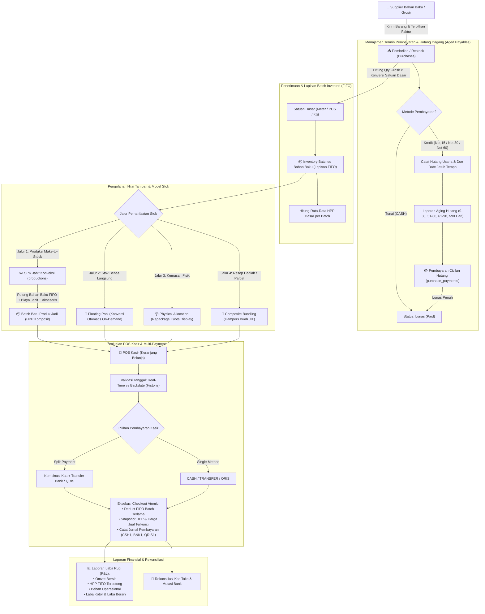
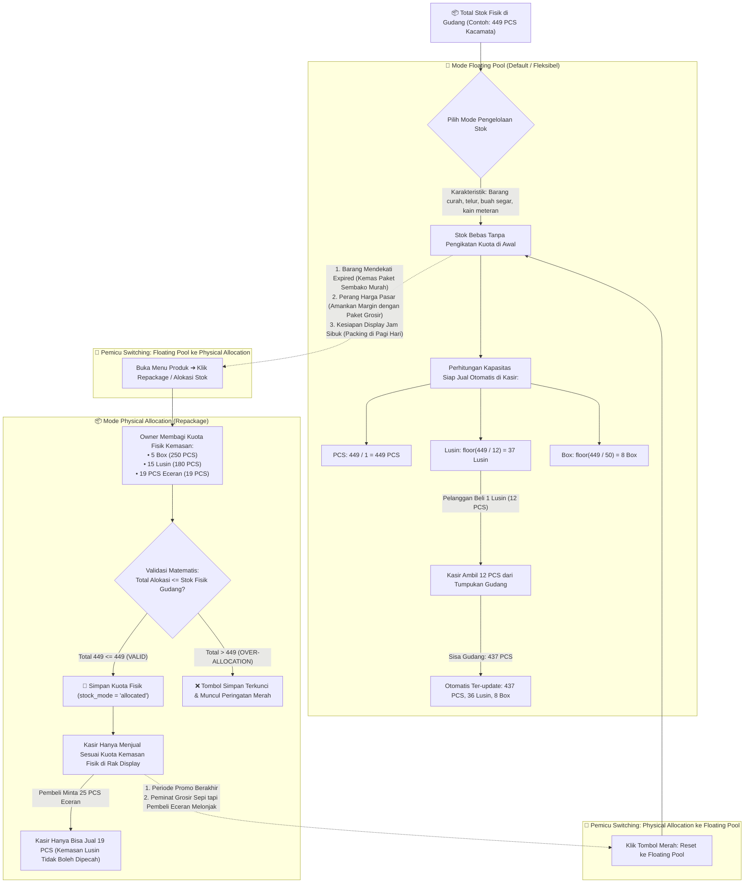
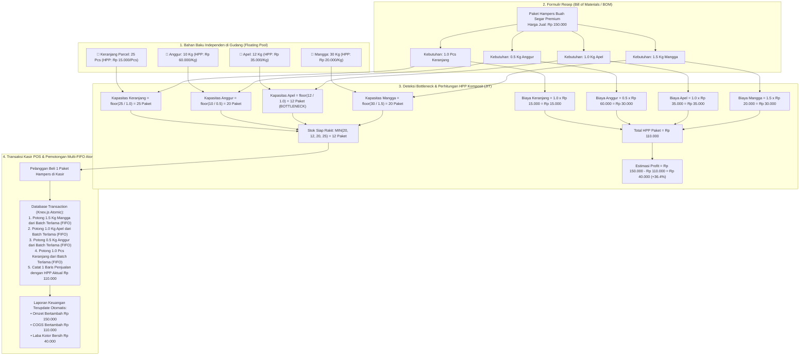
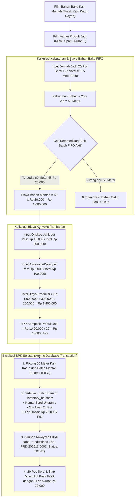
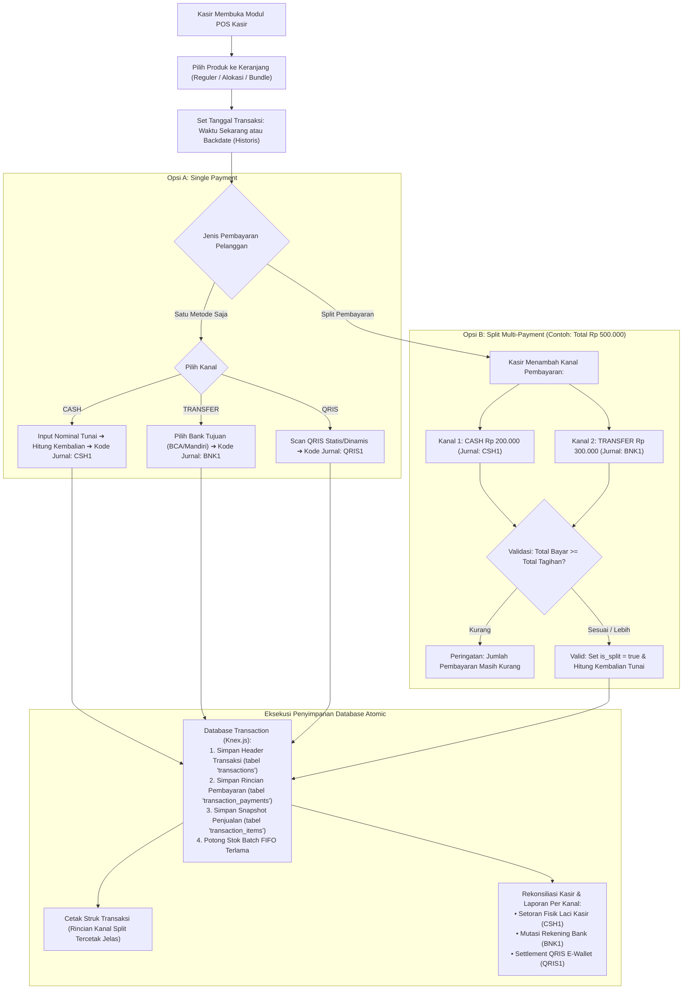

# Invo. — Sistem Point of Sale (POS) & Manajemen Inventori FIFO

Sistem POS & Inventori modern untuk bisnis retail, grosir, manufaktur ringan (konveksi), dan agribisnis dengan pelacakan modal berbasis FIFO (First-In, First-Out), konversi multi-satuan dinamis, dual-mode pengelolaan stok (Physical Allocation vs Floating Pool), paket bundling/hampers multi-item on-demand, manajemen SPK produksi konveksi (Make-to-Stock), manajemen hutang supplier (AP Aged Payables Net 30), serta pembayaran ganda (*split payment*) di kasir.

---

## 🗺️ Diagram Alur Bisnis Lengkap (Comprehensive Business Flow Diagrams)

### 1. Arsitektur Rantai Pasok Terpadu (End-to-End Enterprise Supply Chain)
Diagram di bawah menggambarkan siklus operasional hulu ke hilir: dari pembelian bahan baku ke supplier dengan termin hutang, konversi FIFO, proses produksi konveksi (SPK jahit), pemaketan hampers/repackage, transaksi kasir split payment, hingga rekonsiliasi laba rugi:



---

### 2. Dual-Mode Pengelolaan Stok: Floating Pool vs Physical Allocation & Logika Switching
Diagram alur penentuan mode stok siap jual dan proses peralihan (*switching*) berdasarkan dinamika pasar:



---

### 3. Composite Bundling / Hampers Buah (Model B - On-Demand JIT)
Diagram alur perakitan paket parcel multi-item tanpa perlu pembungkusan fisik di muka (mencegah buah busuk):



---

### 4. Alur Produksi Konveksi: SPK Jahit & Kalkulasi HPP Komposit (Make-to-Stock)
Diagram alur konversi bahan mentah/kain menjadi produk jadi bernilai jual tinggi:



---

### 5. Alur Kasir POS, Split Multi-Payment & Rekonsiliasi Jurnal Keuangan
Diagram alur penanganan kasir dengan berbagai metode bayar, pembayaran parsial (*split payment*), dan kode akun jurnal:



---

## 🌟 Fitur Utama Sistem

### 1. Dual-Mode Pengelolaan Stok Jual
- **Floating Pool (Default):** Seluruh stok tersimpan sebagai satu tumpukan bebas di gudang. Satuan turunan (Box, Lusin, PCS) menghitung kapasitas siap jualnya secara real-time dari sisa stok gudang tanpa mengunci stok fisik.
- **Physical Allocation (Repackage):** Pemilik membagi stok gudang ke dalam kemasan fisik siap jual dengan kuota tertentu di rak display toko, dilengkapi kalkulator live dan proteksi anti over-allocation.
- **Tombol Pintas Dinamis:** `⚡ Alokasikan Sisa ke Eceran` dan `🌊 Reset ke Floating Pool` untuk kemudahan operasional harian.

### 2. Composite Bundling / Paket Hampers (Model B - On-Demand JIT)
- Formula resep (*Bill of Materials*) untuk merakit paket hadiah/parcel dari berbagai komponen barang master.
- Deteksi kapasitas stok siap rakit secara otomatis berdasarkan komponen terendah (*Bottleneck*).
- Pemotongan multi-komponen FIFO secara atomic saat kasir melakukan checkout, mencatat total HPP aktual tanpa mendistorsi laporan laba rugi.

### 3. Make-to-Stock / SPK Jahit Produksi Konveksi
- Surat Perintah Kerja (SPK) untuk mengubah bahan baku mentah (misal: kain katun) menjadi produk jadi bernilai jual tinggi (misal: sprei kasur).
- Perhitungan HPP komposit otomatis: memadukan biaya bahan baku FIFO dengan ongkos tenaga jahit (*labor cost*) dan aksesoris (*accessory cost*).
- Penerbitan batch persediaan barang jadi baru secara otomatis begitu SPK diselesaikan.

### 4. Manajemen Hutang Dagang (Aged Payables & Net 30)
- Mendukung pencatatan pembelian restock secara kredit dengan termin pembayaran fleksibel (*Cash*, *Net 15*, *Net 30*, *Net 60*, atau *Custom*).
- Pelacakan jatuh tempo (*due date*) dan status pelunasan (*paid*, *partially_paid*, *not_paid*).
- Pencatatan pembayaran cicilan hutang supplier via tabel `purchase_payments`.
- Laporan Analisis Umur Hutang (*Aged Payables Report*: 0-30, 31-60, 61-90, dan >90 hari).

### 5. Split Multi-Payment & Multi-Journal Kasir POS
- Pelanggan dapat membayar dengan kombinasi metode (misal: sebagian tunai dan sisanya transfer bank atau QRIS).
- Pelacakan kode akun jurnal penerimaan kas/bank: `CSH1` (Kas Kasir), `BNK1` (Bank Transfer), `QRIS1` (QRIS Settlement).
- Dukungan transaksi penjualan *Real-Time* maupun *Backdate* (pencatatan tanggal lampau untuk migrasi data).

### 6. Laporan Finansial Komprehensif & FIFO Engine
- Laporan Laba Rugi real-time (*Gross Profit* = Omzet - HPP FIFO, *Net Profit* = Laba Kotor - Beban Pengeluaran Operasional).
- Kartu persediaan batch FIFO dengan persentase sisa stok dan indikator peringatan stok menipis (*low-stock alert*).

### 7. Hak Akses Berbasis Peran (RBAC)
- **Owner:** Akses penuh seluruh fitur, konfigurasi harga, SPK jahit, alokasi stok, dan laporan keuangan.
- **Kasir:** Melayani transaksi POS (single/split payment) dan riwayat transaksi harian.
- **Reseller:** Akses portal POS khusus dengan katalog produk bertanda `reseller_visible`.
- **Developer:** Panel isolasi tunggal (*Developer Maintenance*) untuk pemeliharaan dan pembersihan data terfilter tanpa merusak akun pengguna.

---

## 🚀 Panduan Instalasi & Menjalankan

1. **Install Dependensi:**
   ```bash
   npm install
   ```
2. **Jalankan Migrasi Database:**
   ```bash
   npx knex migrate:latest
   ```
3. **Jalankan Server (Development):**
   ```bash
   npm run dev
   # Akses sistem di browser: http://localhost:3000
   ```

## 👤 Akun Bawaan (Default Login)
- **Owner (Admin):** `admin@pos.com` / `admin123`
- **Developer:** `developer@pos.com` / `developer123`
- **Cashier (Kasir):** `kasir@pos.com` / `kasir123`
- **Reseller:** `reseller@pos.com` / `reseller123`
