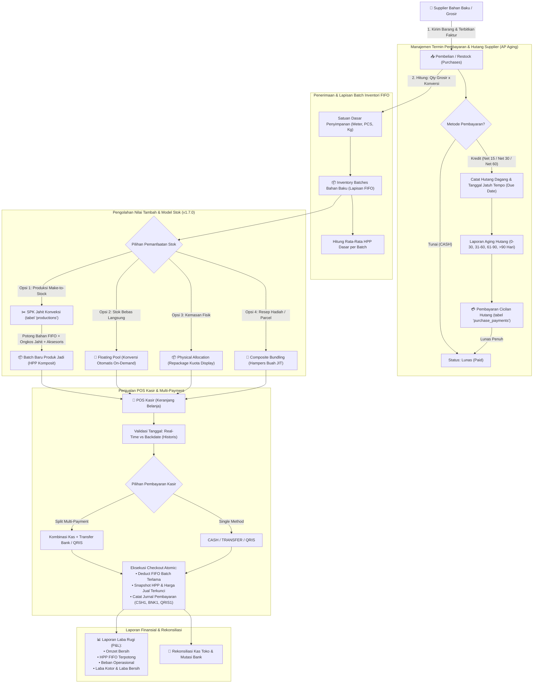
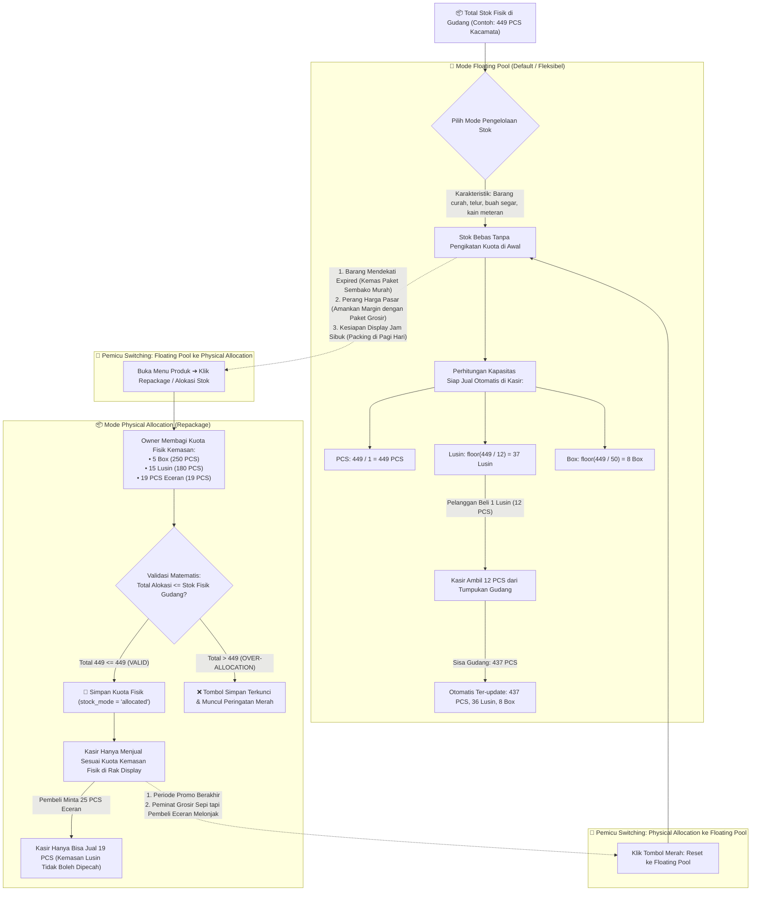
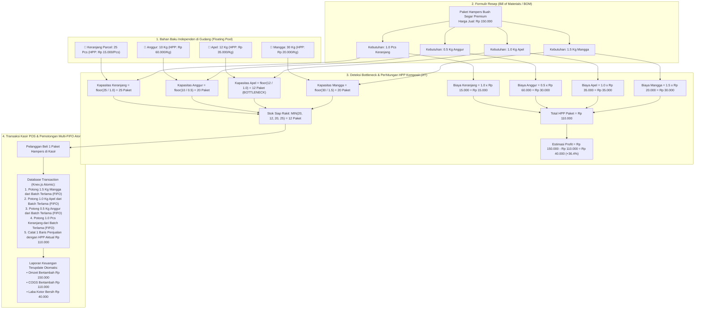
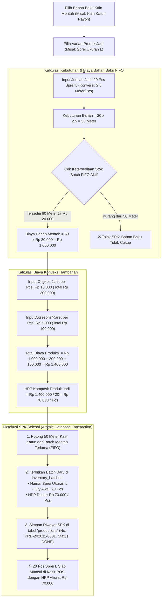
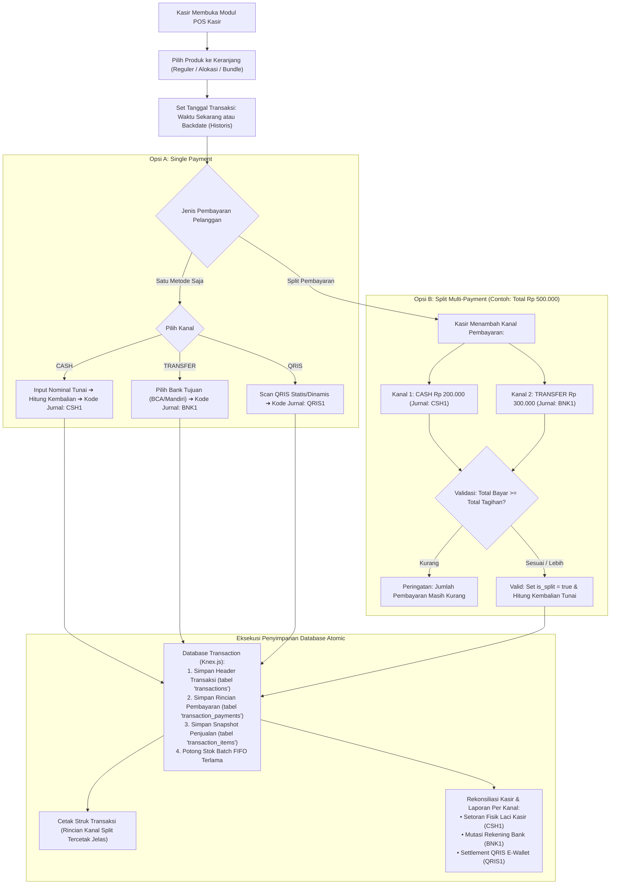
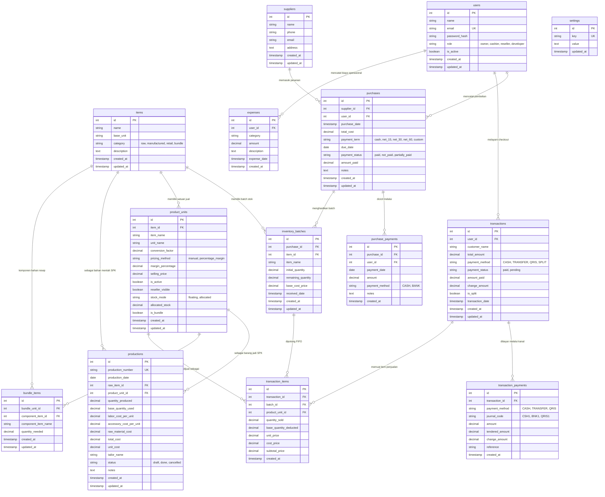

# 📄 PRODUCT REQUIREMENTS DOCUMENT (PRD)
# Sistem POS & Manajemen Inventori Enterprise Multi-Role

---

## 📌 Dokumen Meta & Version Control

| Atribut | Detail |
| :--- | :--- |
| **Nama Proyek** | Multi-Role POS & Inventory System with FIFO, Dual-Mode Stock, Make-to-Stock Production, AP Aging & Split Payment |
| **Status Dokumen** | **APPROVED & IMPLEMENTED** |
| **Versi Terkini** | **v1.7.0** |
| **Tanggal Rilis Terkini** | 15 November 2026 |
| **Arsitektur** | Spec-Driven Development (SDD) & MVC Module Architecture |
| **Stack Teknologi** | Node.js, Express.js, Knex.js, SQLite (better-sqlite3), Vanilla JS SPA, Modern CSS3 SaaS Theme |

---

## 📜 Riwayat Versi (Change Tracking & Changelog)

| Versi | Tanggal | Status | Ringkasan Perubahan |
| :---: | :---: | :---: | :--- |
| **v1.0.0** | 26 Sep 2026 | *Baseline* | Rilis inisial SDD: 9 tabel, stok FIFO satuan dasar, kasir & reseller POS, laporan laba rugi. |
| **v1.1.0** | 27 Sep 2026 | *Superseded* | Upgrade Master Item & Multi-Unit Variant (tabel `items`, single-setup multi-satuan, autocomplete pembelian, direct qty di POS). |
| **v1.2.0** | 27 Sep 2026 | *Superseded* | Data Migration & Backdate POS: Input tanggal backdate di POS Kasir, normalisasi boundary tanggal laporan, reset bersih baris varian, sinkronisasi dinamis label kebutuhan stok. |
| **v1.3.0** | 28 Sep 2026 | *Superseded* | Otomatisasi Harga Jual Berbasis Margin pada Pembelian (Inbound Margin Sync) dengan jaminan integritas data transaksi penjualan historis tidak terpengaruh (frozen snapshot). |
| **v1.4.0** | 28 Sep 2026 | *Superseded* | Role Khusus "Developer" & Modul Pembersihan Data Terfilter: Penambahan peran Developer dengan tampilan antarmuka terisolasi (hanya 1 menu khusus), formulir penghapusan fleksibel (wipe all data atau seleksi form/modul tertentu dengan rentang tanggal), proteksi akun sistem, serta kontrol akses ketat (RBAC). |
| **v1.5.0** | 28 Sep 2026 | *Superseded* | Peremajaan Antarmuka Menyeluruh (Invo. Modern SaaS UI Theme Overhaul) & Visual User Guide: Transformasi desain visual sistem mengikuti desain referensi Invo. dengan palet Electric Blue (`#1a62ff`), desktop window wrapper beraksen 3-dots Mac, logo geometris 3D cube, navigasi kapsul pil menyala, 4 stat cards berikon pastel & badge tren, widget grafik batang vertikal pendapatan bulanan, kartu aksi promosi, serta dokumentasi visual buku panduan yang dilengkapi tangkapan layar (*screenshots*). |
| **v1.6.0** | 30 Sep 2026 | *Superseded* | Dual-Mode Pengelolaan Stok (Physical Allocation vs Floating Pool) & Composite Bundling / Hampers Buah (Model B - On-Demand JIT): Dukungan penuh fleksibilitas stok di pasar nyata. Mode *Floating Pool* untuk konversi bebas otomatis (telur, kain), mode *Physical Allocation (Repackage)* dengan kalkulator kuota real-time dan validasi anti over-allocation, perakitan paket hampers multi-item berbasis resep (*Bill of Materials*) dengan kapasitas bottleneck otomatis, serta pemotongan multi-komponen FIFO atomic saat checkout kasir. |
| **v1.7.0** | 15 Nov 2026 | **Current** | **Make-to-Stock Konveksi (SPK Jahit), Manajemen Hutang Supplier (Aged Payables Net 30), Split Multi-Payment Kasir & Dokumentasi Diagram Alur Bisnis Terintegrasi:** • **Modul Produksi Konveksi (SPK Jahit):** Konversi bahan mentah/kain menjadi barang jadi siap jual dengan kalkulasi HPP Komposit (bahan baku FIFO + ongkos jahit + aksesoris) dan penerbitan batch barang jadi baru otomatis. • **Modul Hutang Usaha & Termin Pembayaran:** Dukungan pembelian kredit (Cash, Net 15, Net 30, Net 60, Custom), jatuh tempo, pencatatan pembayaran cicilan (`purchase_payments`), dan Laporan Analisis Umur Hutang (*Aged Payables Report*). • **Modul Split Multi-Payment Kasir:** Pembayaran ganda kasir (CASH + TRANSFER/QRIS) dengan pencatatan kode jurnal multi-kanal (`CSH1`, `BNK1`, `QRIS1`). • **Diagram Alur Bisnis Mermaid Lengkap:** Menyematkan diagram alur rantai pasok, dual-mode stok, bundling hampers, SPK konveksi, kasir split-payment, dan skema database ERD mutakhir. |

---

## 🏷️ Legenda Penanda Perubahan (Change Highlighting Legend)

* 🟢 `[TAMBAH v1.7]` : Fitur baru pada v1.7.0 (SPK Jahit Konveksi, Hutang Net 30, Split Multi-Payment Kasir, Diagram Mermaid Bisnis).
* 🟢 `[TAMBAH v1.6]` : Fitur pada v1.6.0 (Dual-Mode Stok & Composite Bundling).
* 🟢 `[TAMBAH v1.5]` : Fitur antarmuka pada v1.5.0 (Invo. Design System).
* 🟢 `[TAMBAH v1.4]` : Fitur peran Developer & Data Cleanup pada v1.4.0.
* 🟢 `[TAMBAH v1.3]` : Inbound Margin Auto-Sync pada v1.3.0.
* 🟢 `[TAMBAH v1.2]` : Backdate POS & Reset Form pada v1.2.0.
* 🟢 `[TAMBAH v1.1]` : Master Item & Multi-Unit pada v1.1.0.

---

## 1. EXECUTIVE SUMMARY & BUSINESS CONTEXT

Sistem Point of Sale (POS) dan manajemen inventori konveksi/tekstil/retail/eceran yang mendukung multi-role (*Owner*, *Kasir*, *Reseller*, *Developer*) dengan kemampuan:
1. **Konversi Satuan Bertingkat (Bulk-to-Retail):** Inbound dalam satuan besar grosir (Roll, Kodi, Dus, Bal) yang dikonversi ke **Satuan Dasar** penyimpanan stok (Meter, Yard, PCS, Kg).
2. **Pelacakan Stok FIFO Berbasis Satuan Dasar:** Pengeluaran stok memotong batch tertua (*First In, First Out*) untuk memastikan HPP akurat dan mencegah distorsi valuasi.
3. **Hierarki Master Item & Varian Satuan Jual:** Satu barang induk master dapat memiliki banyak satuan pecahan eceran (contoh: Barang `XXX` dipecah menjadi `Sprei M`, `Sprei L`, `Sprei XL` atau `Kacamata` menjadi `PCS`, `Lusin`, `Box`).
4. **Dual-Mode Pengelolaan Stok Siap Jual (Floating Pool vs Physical Allocation):**
   - *Floating Pool (Default):* Tumpukan stok bebas di gudang, kapasitas terkonversi otomatis ke semua satuan tanpa mengunci stok fisik (ideal untuk barang curah/segar).
   - *Physical Allocation (Repackage):* Alokasi kuota fisik siap jual per kemasan dengan proteksi anti over-allocation, tombol alokasi cepat ke eceran, dan tombol reset ke floating pool kapan saja.
5. **Composite Bundling / Paket Hampers (Model B - On-Demand JIT):**
   - Pembuatan paket parcel multi-item (misal: 1.5kg Mangga + 1.0kg Apel + 0.5kg Anggur + 1 Keranjang).
   - Penentuan stok siap rakit berbasis kapasitas bahan terkecil (*Bottleneck*).
   - Pemotongan stok multi-komponen secara atomic via FIFO saat checkout kasir, merekam HPP komposit akurat di Laporan Laba Rugi.
6. 🟢 `[TAMBAH v1.7]` **Manajemen SPK Produksi Konveksi (Make-to-Stock):**
   - Penerbitan Surat Perintah Kerja (SPK) untuk memproses bahan baku kain menjadi produk jadi.
   - Perhitungan **HPP Komposit**: memadukan biaya bahan baku FIFO aktual dengan ongkos jahit mitra (*labor cost*) dan aksesoris (*accessory cost*).
   - Pemotongan bahan baku dan penerbitan batch persediaan barang jadi baru secara otomatis.
7. 🟢 `[TAMBAH v1.7]` **Manajemen Hutang Dagang Supplier (AP Aged Payables Net 30):**
   - Pembelian restock dengan termin pembayaran kredit (*Cash*, *Net 15*, *Net 30*, *Net 60*, *Custom*).
   - Pelacakan tanggal jatuh tempo (*due date*), status pembayaran (*paid*, *partially_paid*, *not_paid*), dan pencatatan riwayat cicilan (`purchase_payments`).
   - Laporan Analisis Umur Hutang Supplier (*Aged Payables Report*).
8. 🟢 `[TAMBAH v1.7]` **Split Multi-Payment Kasir & Pelacakan Multi-Jurnal:**
   - Transaksi kasir dapat dibayar dengan kombinasi berbagai kanal (misal: tunai + transfer bank/QRIS).
   - Integrasi kode akun jurnal (`CSH1`, `BNK1`, `QRIS1`) untuk rekonsiliasi kas dan mutasi bank.
9. **Kesiapan Migrasi Data Historis (Backdate Transaction):** Input transaksi tanggal lampau (*backdate*) di kasir untuk mempermudah migrasi data nota fisik lama.
10. **Laporan Keuangan Otomatis:** Perhitungan *Gross Profit* (Omzet - HPP FIFO) dan *Net Profit* (Laba Kotor - Pengeluaran Operasional).

---

## 2. PENGGUNA SISTEM (USER PERSONAS & ROLES)

| Role | Tanggung Jawab Utama | Hak Akses |
| :--- | :--- | :--- |
| **Owner (Admin)** | Pemilik toko. Mengatur master barang, supplier, pembelian restock (tunai/kredit), pembayaran hutang dagang, SPK produksi konveksi, alokasi stok (repackage), paket hampers (bundling), keuangan, dan manajemen user. | Akses Penuh (Full Access) ke seluruh modul operasional, inventori, produksi, laporan, dan pengaturan. |
| **Kasir** | Melayani transaksi penjualan offline/di toko secara langsung, termasuk pembayaran tunggal atau split multi-payment dan input transaksi backdate. | POS Kasir, input jumlah barang, input tanggal transaksi, penerimaan pembayaran multi-kanal, riwayat transaksi pribadi. |
| **Reseller** | Tenaga pemasar / agen luar. | POS Penjualan dengan **katalog produk terfilter** (`reseller_visible = true`), riwayat penjualan pribadi. |
| **Developer** | Teknisi / pengembang sistem. Melakukan pemeliharaan, reset data pengujian, atau pembersihan data transaksional lampau. | **Hanya 1 Menu Khusus:** *Developer Maintenance & Data Cleanup*. Seluruh menu kasir, pembelian, inventori, produksi, dan laporan disembunyikan. Akses eksklusif ke API pembersihan data. |

---

## 3. SPESIFIKASI PROSES BISNIS & DIAGRAM ALUR (MERMAID BUSINESS FLOW)

### 3.1 Alur Rantai Pasok Hulu ke Hilir Terintegrasi (Enterprise Supply Chain Flow)

---

### 3.2 Alur Bisnis Dual-Mode Stok: Floating Pool vs Physical Allocation & Logika Switching

---

### 3.3 Alur Bisnis Composite Bundling / Hampers Buah (Model B - On-Demand JIT)

---

### 3.4 Alur Produksi Konveksi: SPK Jahit & Kalkulasi HPP Komposit (Make-to-Stock)

---

### 3.5 Alur Kasir POS, Split Multi-Payment & Rekonsiliasi Jurnal Keuangan

---

## 4. DETIL PERUBAHAN FITUR (GAP & FEATURE HIGHLIGHTS v1.7.0)

### 4.1 Modul Produksi Konveksi & SPK Jahit (`ProductionService` & `Productions.js`)
* 🟢 `[TAMBAH v1.7]` **Fungsi `ProductionService.calculateEstimate`:**
  * Menghitung kebutuhan bahan mentah: $\text{Kebutuhan Meter} = \text{Qty Jadi} \times \text{Konversi}$.
  * Menghitung biaya bahan baku dari batch FIFO terlama yang aktif.
  * Menghitung total biaya: $\text{Total Cost} = \text{Biaya Bahan} + (\text{Ongkos Jahit} \times \text{Qty}) + (\text{Biaya Aksesoris} \times \text{Qty})$.
  * Menghitung **HPP Komposit Satuan Jadi**: $\text{Unit Cost} = \text{Total Cost} / \text{Qty Jadi}$.
* 🟢 `[TAMBAH v1.7]` **Fungsi `ProductionService.executeProduction`:**
  * Memotong stok bahan mentah dari `inventory_batches` lapisan tertua secara atomik.
  * Menerbitkan batch persediaan baru di `inventory_batches` untuk varian produk jadi dengan HPP komposit tersebut.
  * Menyimpan riwayat produksi ke tabel `productions` dengan kode unik format `PRD-YYYYMM-XXXX`.

### 4.2 Modul Hutang Dagang Supplier & Termin Pembayaran (`PurchaseService` & `Purchases.js`)
* 🟢 `[TAMBAH v1.7]` **Termin Pembayaran Fleksibel (Payment Terms):**
  * Mendukung opsi termin: `cash`, `net_15`, `net_30`, `net_60`, dan `custom`.
  * Otomatisasi tanggal jatuh tempo (*due date*) sesuai pilihan termin.
  * Status pembayaran: `paid` (lunas), `partially_paid` (sebagian), dan `not_paid` (belum bayar).
* 🟢 `[TAMBAH v1.7]` **Tabel Pembayaran Cicilan (`purchase_payments`):**
  * Mencatat setiap transaksi pembayaran hutang ke supplier (nominal, tanggal, metode kas/bank, dan catatan).
* 🟢 `[TAMBAH v1.7]` **Laporan Umur Hutang (Aged Payables Report):**
  * Mengelompokkan kewajiban hutang supplier ke dalam rentang: *Current (Belum Jatuh Tempo)*, *1-30 Hari*, *31-60 Hari*, *61-90 Hari*, dan *>90 Hari Terlambat*.

### 4.3 Modul Split Multi-Payment & Multi-Journal Kasir (`TransactionService` & `POS.js`)
* 🟢 `[TAMBAH v1.7]` **Penyimpanan Multi-Kanal Pembayaran (`transaction_payments`):**
  * Mendukung pelunasan kasir dengan kombinasi kanal bayar.
  * Menyimpan kode jurnal akuntansi: `CSH1` (Kas Toko), `BNK1` (Bank BCA/Mandiri), `QRIS1` (QRIS Settlement).
  * Validasi over-payment pada kanal non-tunai (uang kembalian hanya diperbolehkan jika berasal dari porsi tunai).

### 4.4 Modul Repackage & Alokasi Stok Fisik (`InventoryService` & `ProductsComponent`)
* Mengizinkan pembagian stok gudang menjadi kuota kemasan fisik siap jual (Box, Lusin, PCS promo) dengan perlindungan anti over-allocation dan tombol reset instan ke floating pool.

### 4.5 Modul Composite Bundling & Resep Hampers (`InventoryService` & `ProductsComponent`)
* Mengizinkan perakitan paket multi-item berdasarkan resep (*Bill of Materials*), menghitung kapasitas bottleneck secara dinamis, dan memotong multi-komponen FIFO saat checkout.

---

## 5. SKEMA DATABASE TERKINI (DATABASE SCHEMA v1.7.0)

---

## 6. SPESIFIKASI ENDPOINT REST API (API v1.7.0)

### 6.1 SPK Produksi Konveksi (`/api/productions`)
* `GET /api/productions` — Mengambil seluruh daftar riwayat SPK produksi.
* `POST /api/productions/estimate` — Menghitung preview estimasi HPP komposit dan validasi stok bahan baku.
* `POST /api/productions` — Menerbitkan dan mengeksekusi SPK jahit, memotong bahan baku FIFO dan menerbitkan batch barang jadi baru.
* `GET /api/productions/:id` — Detail dokumen SPK produksi dan rincian biaya.

### 6.2 Manajemen Hutang Supplier & Pembelian (`/api/purchases`)
* `POST /api/purchases` — Mencatat pembelian restock (mendukung `paymentTerm`, `dueDate`, `paymentStatus`, dan `amountPaid`).
* `POST /api/purchases/:id/payments` — Mencatat pembayaran cicilan hutang supplier ke tabel `purchase_payments`.
* `GET /api/purchases/aged-payables` — Laporan analisis umur hutang supplier (*Aged Payables Summary & Detail*).

### 6.3 Repackage & Alokasi Stok (`/api/products`)
* `POST /api/products/repackage` — Alokasi kuota fisik per satuan jual dengan validasi anti over-allocation.
* `POST /api/products/repackage/reset` — Reset kuota fisik kembali ke mode Floating Pool bebas.

### 6.4 Composite Bundling (`/api/products`)
* `POST /api/products/bundle` — Pembuatan paket hampers/bundling multi-item dengan resep *Bill of Materials*.
* `GET /api/products/bundle/:id/recipe` — Melihat rincian komponen bahan penyusun paket hampers.

### 6.5 Checkout POS Kasir & Split Payment (`/api/transactions`)
* `POST /api/transactions/checkout` — Checkout penjualan kasir dengan dukungan:
  - Pembayaran tunggal (`paymentMethod`) atau pembayaran ganda (`payments: [{ paymentMethod, journalCode, amount, tenderedAmount }]`).
  - Pencatatan backdate historis (`transactionDate`).
  - Pemotongan stok multi-komponen FIFO atomic untuk produk bundling.

---

## 7. KRITERIA PENERIMAAN & PENGUJIAN (ACCEPTANCE CRITERIA)

| Kode Uji | Deskripsi Skenario | Hasil yang Diharapkan | Status |
| :---: | :--- | :--- | :---: |
| **AC-01** | Input Pembelian 1 Kodi bahan mentah XXX seharga Rp 1.200.000 dengan konversi 60 Meter. | Batch FIFO tersimpan 60 Meter dengan HPP Rp 20.000/meter. Barang XXX otomatis ada di master item. | **PASSED** |
| **AC-02** | Setup Multi-Satuan barang XXX: Sprei M (2m), Sprei L (2.5m, Margin 40%), Sprei XL (3m, Margin 50%) dalam 1 modal. | Ketiga satuan tersimpan sekaligus. Harga Sprei L otomatis Rp 70rb, Sprei XL otomatis Rp 90rb. | **PASSED** |
| **AC-03** | Transaksi POS Backdate pada 15 Agustus 2026. | Transaksi tersimpan dengan `transaction_date = 2026-08-15`. Nota struk dan laporan Agustus merekam transaksi ini. | **PASSED** |
| **AC-04** | Verifikasi Laporan Periode Backdate (Agustus 2026). | Laporan Penjualan dan Laba Rugi periode Agustus mencatat Omzet Rp 70.000, COGS Rp 20.000, Laba Kotor Rp 50.000. | **PASSED** |
| **AC-05** | Buka Modal Setup Produk Baru & Ubah Textbox Satuan Dasar ke "Yard". | Daftar satuan jual bersih, header kolom kebutuhan tabel satuan jual seketika berubah menjadi `Kebutuhan (Yard)`. | **PASSED** |
| **AC-06** | Setup Barang Kacamata margin 50% (harga awal 0) lalu input Pembelian perdana @ Rp 100.000. | Harga jual `product_units` varian Kacamata Hitam otomatis berubah dari Rp 0 menjadi Rp 150.000. | **PASSED** |
| **AC-07** | Transaksi Penjualan Rp 150.000 diikuti Pembelian ke-2 @ Rp 200.000. | Harga jual katalog naik menjadi Rp 228.947, namun snapshot `transaction_items.unit_price` transaksi lama tetap Rp 150.000. | **PASSED** |
| **AC-08** | Login dengan akun Role Developer (`developer@pos.com`). | Hanya muncul 1 menu tunggal (Developer Maintenance). Mencoba navigasi rute lain tetap terkunci di menu Developer. | **PASSED** |
| **AC-09** | Eksekusi penghapusan data terfilter dengan rentang tanggal. | Data pada modul terpilih dalam rentang tanggal terhapus bersih, sedangkan data di luar periode tanggal tetap utuh. | **PASSED** |
| **AC-10** | Tampilan Dashboard & Seluruh Halaman dengan Tema Invo. Modern SaaS. | Window wrapper beraksen 3-dots Mac, logo 3D Invo, navigasi kapsul pil menyala `#1a62ff`, 4 stat cards pastel, dan grafik bulanan tampil presisi. | **PASSED** |
| **AC-11** | Alokasi Kuota Fisik (Repackage) Valid. | Total alokasi 5 Box, 15 Lusin, 19 PCS (total 449 PCS) berhasil disimpan, `stock_mode` menjadi `allocated`. | **PASSED** |
| **AC-12** | Proteksi Validasi Over-Allocation Repackage. | Alokasi 10 Box (500 PCS) melebihi stok gudang (399 PCS) ditolak dengan error 400 dan tombol simpan terkunci otomatis. | **PASSED** |
| **AC-13** | Reset Alokasi Fisik ke Mode Floating Pool Bebas. | Tombol `Reset ke Floating Pool` mengembalikan seluruh satuan ke konversi otomatis on-demand tanpa merusak layer FIFO. | **PASSED** |
| **AC-14** | Pembuatan Resep Paket Hampers & Deteksi Bottleneck. | Paket hampers buah dengan 4 komponen berhasil dibuat, kapasitas stok siap rakit terdeteksi otomatis dari komponen terendah (*bottleneck*). | **PASSED** |
| **AC-15** | Checkout Kasir Paket Hampers & Pemotongan Multi-FIFO. | Penjualan 1 Paket Hampers memotong masing-masing komponen dari batch FIFO terlama secara atomic, merekam HPP komposit akurat. | **PASSED** |
| **AC-16** | 🟢 `[TAMBAH v1.7]` Eksekusi SPK Produksi Konveksi & HPP Komposit. | SPK 20 Pcs Sprei L memotong 50m kain katun secara FIFO, menambahkan ongkos jahit Rp 15rb & aksesoris Rp 5rb, menerbitkan batch baru dengan HPP komposit Rp 70.000/pcs. | **PASSED** |
| **AC-17** | 🟢 `[TAMBAH v1.7]` Pembelian Kredit Net 30 & Pelunasan Cicilan Hutang. | Pembelian termin Net 30 tercatat dengan status `not_paid` dan due date +30 hari. Input cicilan di `purchase_payments` meng-update sisa hutang dan status menjadi `partially_paid` atau `paid`. | **PASSED** |
| **AC-18** | 🟢 `[TAMBAH v1.7]` Checkout Kasir Split Multi-Payment. | Transaksi total Rp 500.000 dibayar CASH Rp 200.000 dan TRANSFER Rp 300.000 berhasil disimpan dengan `is_split = true` dan terekam 2 baris jurnal di `transaction_payments`. | **PASSED** |
