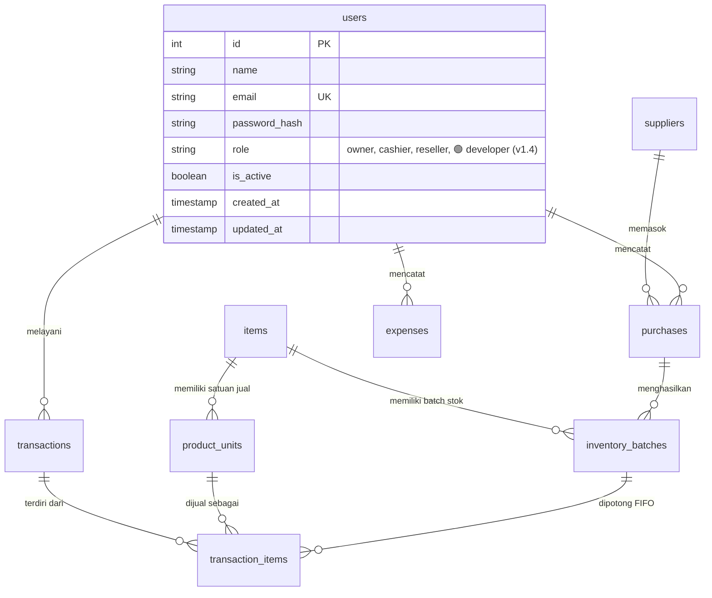

# 📄 PRODUCT REQUIREMENTS DOCUMENT (PRD)
# Sistem POS & Manajemen Inventori Multi-Role

---

## 📌 Dokumen Meta & Version Control

| Atribut | Detail |
| :--- | :--- |
| **Nama Proyek** | Multi-Role POS & Inventory System with FIFO & Multi-Unit Conversion |
| **Status Dokumen** | **APPROVED & IMPLEMENTED** |
| **Versi Terkini** | **v1.5.0** |
| **Tanggal Rilis Terkini** | 28 September 2026 |
| **Arsitektur** | Spec-Driven Development (SDD) & MVC Module Architecture |
| **Stack Teknologi** | Node.js, Express.js, Knex.js, SQLite (better-sqlite3), Vanilla JS SPA, Modern CSS3 SaaS Theme |

---

## 📜 Riwayat Versi (Change Tracking & Changelog)

| Versi | Tanggal | Status | Ringkasan Perubahan |
| :---: | :---: | :---: | :--- |
| **v1.0.0** | 26 Sep 2026 | *Baseline* | Rilis inisial SDD: 9 tabel, stok FIFO satuan dasar, kasir & reseller POS, laporan laba rugi. |
| **v1.1.0** | 27 Sep 2026 | *Superseded* | Upgrade Master Item & Multi-Unit Variant (tabel `items`, single-setup multi-satuan, autocomplete pembelian, direct qty di POS). |
| **v1.2.0** | 27 Sep 2026 | *Superseded* | Data Migration & Backdate POS: Input tanggal backdate di POS Kasir, normalisasi boundary tanggal laporan, reset bersih baris varian, sinkronisasi dinamis label kebutuhan stok. |
| **v1.3.0** | 28 Sep 2026 | *Superseded* | Otomatisasi Harga Jual Berbasis Margin pada Pembelian (Inbound Margin Sync) dengan jaminan integritas data transaksi penjualan historis tidak terpengaruh (frozen snapshot). |
| **v1.4.0** | 28 Sep 2026 | *Superseded* | Role Khusus "Developer" & Modul Pembersihan Data Terfilter: Penambahan peran Developer dengan tampilan antarmuka terisolasi (hanya 1 menu khusus), formulir penghapusan fleksibel (wipe all data atau seleksi form/modul tertentu dengan rentang tanggal), proteksi akun sistem, serta kontrol akses ketat (RBAC). |
| **v1.5.0** | 28 Sep 2026 | **Current** | **Peremajaan Antarmuka Menyeluruh (Invo. Modern SaaS UI Theme Overhaul) & Visual User Guide:** Transformasi desain visual sistem mengikuti desain referensi Invo. dengan palet Electric Blue (`#1a62ff`), desktop window wrapper beraksen 3-dots Mac, logo geometris 3D cube, navigasi kapsul pil menyala dengan nama menu orisinal yang dipertahankan, 4 stat cards berikon pastel & badge tren, widget grafik batang vertikal pendapatan bulanan, kartu aksi promosi, serta dokumentasi visual buku panduan yang dilengkapi tangkapan layar (*screenshots*) pada setiap modul dan formulir. |

---

## 🏷️ Legenda Penanda Perubahan (Change Highlighting Legend)

* 🟢 `<span class="badge-add">[TAMBAH v1.5]</span>` : Fitur, komponen UI, atau token desain baru pada v1.5.0 (Invo. Design System).
* 🟡 `<span class="badge-mod">[UBAH v1.5]</span>` : Modifikasi layout, skema styling, atau struktur dashboard pada v1.5.0.
* 🟢 `<span class="badge-add">[TAMBAH v1.4]</span>` : Fitur yang ditambahkan pada rilis v1.4.0 (Role Developer & Cleanup Panel).
* 🟢 `<span class="badge-add">[TAMBAH v1.3]</span>` : Fitur yang ditambahkan pada rilis v1.3.0 (Inbound Margin Auto-Sync).
* 🟢 `<span class="badge-add">[TAMBAH v1.2]</span>` : Fitur yang ditambahkan pada rilis v1.2.0 (Backdate POS & Reset Form).
* 🟢 `<span class="badge-add">[TAMBAH v1.1]</span>` : Fitur yang ditambahkan pada rilis v1.1.0 (Master Item & Multi-Unit).
* 🔴 `<span class="badge-del">[HAPUS / DEPRECATED]</span>` : Alur lama yang dihapus/ditinggalkan demi integritas data & efisiensi.

---

## 1. EXECUTIVE SUMMARY & BUSINESS CONTEXT

Sistem Point of Sale (POS) dan manajemen inventori konveksi/tekstil/eceran yang mendukung multi-role (*Owner*, *Kasir*, *Reseller*, *Developer*) dengan kemampuan:
1. **Konversi Satuan Bertingkat (Bulk-to-Retail):** Inbound dalam satuan besar grosir (Roll, Kodi, Bal) yang dikonversi ke **Satuan Dasar** penyimpanan stok (Meter, Yard, Pcs).
2. **Pelacakan Stok FIFO Berbasis Satuan Dasar:** Pengeluaran stok memotong batch tertua (*First In, First Out*) untuk memastikan HPP akurat dan mencegah distorsi valuasi.
3. **Hierarki Master Item & Varian Satuan Jual:** Satu barang induk master dapat memiliki banyak satuan pecahan eceran (contoh: Barang `XXX` dipecah menjadi `Sprei M`, `Sprei L`, `Sprei XL`) yang dikonfigurasi dalam **satu kali setup (*single flow*)**.
4. 🟢 `[TAMBAH v1.2]` **Kesiapan Migrasi Data Historis (Backdate Transaction):** Memfasilitasi proses *go-live* dan migrasi data transaksi lampau toko melalui input tanggal transaksi (*backdate*) di POS Kasir dengan akurasi pencatatan laporan keuangan sesuai tanggal historis.
5. 🟢 `[TAMBAH v1.3]` **Otomatisasi Penetapan Harga Jual Berbasis Margin (% Margin Sync):** Ketika barang di-setup dengan metode persentase profit sebelum ada riwayat pembelian (harga jual awal Rp 0), pencatatan restock pembelian perdana maupun selanjutnya otomatis menghitung HPP tertimbang dan memperbarui harga jual di menu Produk & Satuan, tanpa mengubah sedikit pun nota transaksi penjualan lampau.
6. 🟢 `[TAMBAH v1.4]` **Manajemen Pemeliharaan & Reset Data Khusus (Role Developer):** Menyediakan akun khusus peran *Developer* yang terisolasi hanya dapat mengakses 1 menu *Maintenance*, untuk membersihkan data uji coba atau menghapus data spesifik per form/modul dalam rentang tanggal tertentu secara aman.
7. **Laporan Keuangan Otomatis:** Perhitungan *Gross Profit* (Omzet - HPP FIFO) dan *Net Profit* (Laba Kotor - Pengeluaran Operasional).

---

## 2. PENGGUNA SISTEM (USER PERSONAS & ROLES)

| Role | Tanggung Jawab Utama | Hak Akses |
| :--- | :--- | :--- |
| **Owner (Admin)** | Pemilik toko. Mengatur master barang, supplier, pembelian restock, penetapan harga multi-satuan, migrasi data, keuangan, dan manajemen user. | Akses Penuh (Full Access) ke seluruh modul operasional, inventori, laporan, dan pengaturan. |
| **Kasir** | Melayani transaksi penjualan offline/di toko secara langsung, termasuk input transaksi backdate jika didelegasikan saat migrasi data. | POS Kasir, input jumlah barang, input tanggal transaksi, penerimaan pembayaran (CASH/TRANSFER/QRIS), riwayat transaksi pribadi. |
| **Reseller** | Tenaga pemasar / agen luar. | POS Penjualan dengan **katalog produk terfilter** (`reseller_visible = true`), riwayat penjualan pribadi. |
| 🟢 `[TAMBAH v1.4]` **Developer** | Teknisi / pengembang sistem. Melakukan pemeliharaan, reset data pengujian, atau pembersihan data transaksional lampau. | **Hanya 1 Menu Khusus:** *Developer Maintenance & Data Cleanup*. Seluruh menu kasir, pembelian, inventori, dan laporan disembunyikan. Akses eksklusif ke API pembersihan data. |

---

## 3. SPESIFIKASI PROSES BISNIS & PERUBAHAN SISTEM

### 3.1 Alur Rantai Pasok (Supply Chain Flow)

```
[Supplier] ➔ [Pembelian / Restock] ➔ [Master Item & Multi-Satuan] ➔ [POS Kasir (Real-time / Backdate)] ➔ [Laporan Keuangan]
```

#### Alur Hulu ke Hilir Terkini (v1.2.0):
1. **Master Item & Satuan Dasar:** Barang master terdaftar di tabel `items` dengan **Satuan Dasar Matematis** (contoh: `Meter`, `Pcs`, `Kg`).
2. **Inbound Restock (Bisa Backdate):** Pembelian dicatat dengan tanggal penerimaan fisik barang (`purchase_date`). Batch stok FIFO mencatat tanggal masuk tersebut.
3. 🟡 `[UBAH v1.2]` **Setup Satuan Jual Dinamis:** 
   - Dilakukan serentak dalam satu formulir Master-Detail.
   - Daftar baris satuan jual **selalu di-reset bersih** setiap kali setup dibuka.
   - Kolom kebutuhan bahan selalu **tersinkronisasi secara dinamis** dengan isi textbox *Satuan Dasar Perhitungan Stok*.
4. 🟢 `[TAMBAH v1.2]` **Penjualan Kasir Fleksibel (Current & Backdate):**
   - Transaksi kasir dapat dicatat secara *real-time* ataupun *backdate* (mundur tanggal) saat migrasi data historis toko.
   - Pemotongan FIFO tetap memprioritaskan batch tertua yang tersedia.

---

### 3.2 Skenario Tantangan Riil (Challenge Case: Barang "XXX")

> **Studi Kasus:**
> Sebuah barang dengan nama **"XXX"** dibeli dalam satuan grosir **Kodi** (seharga Rp 1.200.000, di mana 1 Kodi = 60 Meter).
> Toko menjualnya dalam 3 ukuran eceran:
> 1. **Sprei M:** Butuh bahan `2.0 Meter` | Metode: `Manual Rp 60.000`
> 2. **Sprei L:** Butuh bahan `2.5 Meter` | Metode: `% Margin 40%` ➔ Terhitung Rp 70.000
> 3. **Sprei XL:** Butuh bahan `3.0 Meter` | Metode: `% Margin 50%` ➔ Terhitung Rp 90.000

#### Kalkulasi Matematis Sistem:
$$\text{HPP Dasar per Meter} = \frac{\text{Total Biaya Beli}}{\text{Total Meter Didapat}} = \frac{\text{Rp } 1.200.000}{60\text{ Meter}} = \mathbf{\text{Rp } 20.000/\text{Meter}}$$

| Satuan Jual | Kebutuhan Bahan | HPP per Pcs | Skema Penetapan | Harga Jual | Estimasi Profit |
| :--- | :---: | :---: | :--- | :---: | :---: |
| **Sprei M** | 2.0 Meter | $2.0 \times 20.000 = \text{Rp } 40.000$ | Manual Rp | **Rp 60.000** | Rp 20.000 (+50.0%) |
| **Sprei L** | 2.5 Meter | $2.5 \times 20.000 = \text{Rp } 50.000$ | Margin +40% | **Rp 70.000** | Rp 20.000 (+40.0%) |
| **Sprei XL** | 3.0 Meter | $3.0 \times 20.000 = \text{Rp } 60.000$ | Margin +50% | **Rp 90.000** | Rp 30.000 (+50.0%) |

---

### 3.3 🟢 `[TAMBAH v1.3]` Skenario Kasus Kacamata (Inbound Margin Auto-Sync & Historical Freeze)

> **Studi Kasus:**
> Pemilik usaha melakukan setup Master Item baru bernama **"Kacamata"** dengan Satuan Dasar **PCS**.
> Pada setup satuan jual, didaftarkan varian **"Kacamata Hitam"** (konversi: 1.0 PCS) dengan metode harga **% Margin 50%**.
> Karena barang ini baru dan belum pernah ada transaksi pembelian restock yang dicatat, maka saat disimpan, harga jual awal adalah **Rp 0** (HPP awal 0).
>
> **Tantangan Bisnis:**
> Ketika pemilik usaha mencatat pembelian perdana (misal: 10 PCS @ Rp 100.000), sistem sebelumnya tidak memperbarui harga jual di Produk & Satuan, sehingga kasir melihat harga Rp 0 atau pemilik toko harus mengedit manual ulang.
>
> **Solusi Sistem v1.3.0 (Opsi 1):**
> 1. **Auto-Generate on Inbound:** Saat transaksi pembelian dicatat di modul Pembelian, sistem secara reaktif menghitung HPP tertimbang batch aktif dan langsung meng-update `product_units.selling_price` menjadi:
>    $$\text{Harga Jual Baru} = \text{HPP Dasar} \times \text{Konversi} \times (1 + \text{Margin \%}) = 100.000 \times 1.0 \times 1.5 = \mathbf{\text{Rp } 150.000}$$
> 2. **Perlindungan Integritas Data Historis (*Historical Snapshot Guarantee*):**
>    Ketika di masa depan terjadi restock berikutnya dengan harga modal baru (misal Rp 200.000) yang menyebabkan harga jual katalog naik menjadi Rp 228.947, **seluruh transaksi penjualan yang telah terjadi sebelumnya TIDAK IKUT TERUBAH**. Nilai harga jual dan harga modal masa lalu tetap terkunci permanen pada snapshot tabel `transaction_items.unit_price` dan `cost_price`.

---

## 4. DETIL PERUBAHAN FITUR (GAP & CHANGE HIGHLIGHTS v1.3.0)

### 4.1 Modul Pembelian & Restock (`InventoryService` & `Purchases.js`)
* 🟢 `[TAMBAH v1.3]` **Otomatisasi Sinkronisasi Harga Margin pada Pembelian:**
  * Setelah batch inventori (`inventory_batches`) berhasil dibuat, `InventoryService.recordPurchase` secara otomatis memanggil `PricingService.syncItemMarginPrices(trx, itemId/itemName)`.
  * Sistem mengidentifikasi semua unit satuan aktif milik barang tersebut yang memiliki metode `percentage_margin` dan menghitung harga jual barunya.
  * Hasil sinkronisasi (`autoUpdatedPrices`) dikembalikan dalam response API pembelian.
* 🟡 `[UBAH v1.3]` **Notifikasi Toast Informatif:**
  * Antarmuka web kasir/owner menampilkan toast dinamis jika ada harga jual yang terupdate otomatis, contoh:
    > *"Pembelian berhasil! 1 harga jual satuan (% margin) otomatis diperbarui: Kacamata Hitam: Rp 150.000"*

### 4.2 Modul Pricing & Model (`PricingService`)
* 🟢 `[TAMBAH v1.3]` **Method `syncItemMarginPrices(trx, itemNameOrId)`:**
  * Menghitung *weighted average base cost* dari seluruh batch aktif (`remaining_quantity > 0`).
  * Mengabaikan batch kosong demi akurasi HPP berjalan.
  * Mengupdate kolom `product_units.selling_price` dan `updated_at` secara transaksional (*atomic*).

### 4.3 Modul POS Kasir (`POSComponent`)
* 🟢 `[TAMBAH v1.2]` **Input Tanggal Transaksi (Backdate):**
  * Ditambahkan field `📅 Tanggal Transaksi` (`<input type="datetime-local" id="txDate">`) pada panel checkout keranjang kasir.
  * Dilengkapi tombol shortcut **"Sekarang"** yang mengembalikan tanggal dan jam ke waktu saat ini.
  * Memungkinkan input transaksi pada periode tanggal lampau (contoh: `2026-08-15 14:30`) untuk migrasi data penjualan sebelum sistem diterapkan.
* 🟢 `[TAMBAH v1.2]` **Penerusan Parameter Tanggal ke API:**
  * Payload checkout menyertakan `transactionDate: ISOString`.
  * Database menyimpan `transactions.transaction_date` dan `transaction_items.created_at` sesuai nilai backdate yang dipilih.

### 4.4 Modul Produk & Satuan (`ProductsComponent`)
* 🟡 `[UBAH v1.2]` **Reset Bersih Daftar Baris Satuan Jual:**
  * Setiap kali formulir setup dibuka (baik setup barang baru maupun pilih barang dari daftar), daftar baris satuan jual **selalu di-reset bersih** (menghapus baris contoh statis yang tidak relevan).
* 🟢 `[TAMBAH v1.2]` **Sinkronisasi Dinamis Label Kebutuhan Stok:**
  * Kolom header tabel: `Kebutuhan (<span class="lblBaseUnit">...</span>)`.
  * Nilai label otomatis berubah mengikuti isi pengetikan pada textbox *Satuan Dasar Perhitungan Stok* (`muBaseUnit`) secara *real-time* (contoh: jika user mengetik `Yard`, label langsung berubah menjadi `Kebutuhan (Yard)`).
* 🟡 `[UBAH v1.2]` **Pembaruan Teks Caption Petunjuk:**
  * Teks panduan di atas tabel satuan jual diperbarui menjadi:
    > *"Tentukan ukuran pecahan eceran anda (misal: satuan jual 1 Sprei M butuh 2.0 Satuan Dasar Perhitungan Stok (sebagai contoh : meter) dan  Sprei L butuh 2.5 Satuan Dasar Perhitungan Stok (sebagai contoh : meter). Sistem akan menghitung HPP otomatis berdasarkan harga modal per meter di gudang."*

### 4.5 Modul Laporan Keuangan (`ReportService`)
* 🟢 `[TAMBAH v1.2]` **Normalisasi Rentang Waktu Tanggal:**
  * Fungsi pembacaan laporan (Penjualan, Detail Item, Laba Rugi, Performa Kasir) kini menormalkan batas `startDate` menjadi `00:00:00` dan `endDate` menjadi `23:59:59`.
  * Memastikan transaksi backdate yang diinput dengan jam berapa pun dalam tanggal tersebut terhitung 100% akurat dalam rentang periode filter.

### 4.6 🟢 `[TAMBAH v1.4]` Modul Pemeliharaan & Reset Data Developer (`DeveloperService` & `DeveloperComponent`)
* **Isolasi Tampilan Antarmuka Khusus Role Developer:**
  * Pengguna dengan role `developer` saat login **hanya disuguhkan 1 menu tunggal**: *Developer Maintenance*.
  * Seluruh navigasi kasir (POS), stok gudang, pembelian, supplier, laporan, user management, dan settings disembunyikan total demi keamanan operasional.
  * Percobaan navigasi ke rute halaman lain secara otomatis dialihkan kembali ke panel developer.
* **Formulir Penghapusan Data Fleksibel & Terfilter:**
  * **Opsi 1 — Wipe All Data (`mode: 'all'`):** Menghapus seluruh data transaksi penjualan, nota pembelian, batch persediaan FIFO, satuan jual katalog, master barang, data supplier, dan biaya operasional. Akun pengguna dan konfigurasi toko tetap terlindungi.
  * **Opsi 2 — Filtered Deletion (`mode: 'filtered'`):** Memungkinkan developer memilih form/modul mana saja yang ingin dibersihkan (Transaksi POS, Pembelian & Batch, Biaya, Produk, Item, Supplier) dalam rentang tanggal tertentu (`startDate` s/d `endDate`).
* **Proteksi Integritas Foreign Key & Keamanan:**
  * Eksekusi penghapusan berjalan dalam *database transaction* dengan urutan pembersihan terbalik (*reverse dependency*) untuk mencegah kegagalan relasi foreign key.
  * Dilengkapi konfirmasi ketik kata `"DELETE"` untuk mencegah eksekusi yang tidak disengaja.

---

## 4. 🟢 [TAMBAH v1.5] SPESIFIKASI SISTEM DESAIN & UI THEME OVERHAUL (INVO. DESIGN SYSTEM)

Untuk meningkatkan standar visual estetika, pengalaman pengguna (*User Experience / UX*), serta memberikan nuansa aplikasi enterprise modern kelas atas setara SaaS global, antarmuka sistem dirombak menyeluruh mengacu pada desain **Invo. Modern SaaS Dashboard**:

### 4.1 Elemen Desain Kunci (Design System Tokens)
* **Warna Utama (Electric Blue Brand):**
  * `Primary Accent`: `#1a62ff` (Vibrant Electric Blue)
  * `Primary Hover`: `#0d52e6`
  * `Primary Shadow / Glow`: `0 8px 18px -4px rgba(26, 98, 255, 0.4)`
  * `Canvas / Background`: `#f4f6fb` (Ultra-soft Cool Grayish White)
  * `Surface / Cards`: `#ffffff` dengan border halus `1px solid rgba(226, 232, 240, 0.8)` dan bayangan lembut.
* **Tipografi Modern:**
  * Font Family: `'Plus Jakarta Sans', -apple-system, BlinkMacSystemFont, 'Segoe UI', Roboto, sans-serif`.
* **Desktop Window Wrapper & Mac Decorative Dots:**
  * Menyelubungi viewport konten dengan aksen jendela desktop modern berujung membulat (*border-radius: 20px*).
  * Dihiasi tombol jendela 3 titik khas macOS di sudut kiri atas: 🔴 `#ff5f56` (Close), 🟡 `#ffbd2e` (Minimize), 🟢 `#27c93f` (Maximize).
* **Identitas Brand & Logo 3D:**
  * Logo kubus isometrik 3D biru gradien dengan teks tebal berkarakter: **`Invo.`**

### 4.2 Struktur Layout Dashboard 3 Baris (3-Row Executive Dashboard)
1. **Top Row (4 Stat Cards Pastel):**
   * *Total Revenue (Pendapatan):* Icon bulat oranye pastel (`#fff7ed` / `#ea580c`), trend pill hijau (`341 ↑`).
   * *Invoices / Transaksi:* Icon bulat hijau pastel (`#f0fdf4` / `#16a34a`), trend pill hijau (`121 ↑`).
   * *Clients / Pelanggan & Reseller:* Icon bulat biru muda pastel (`#eff6ff` / `#2563eb`), trend pill hijau (`51 ↑`).
   * *Loyalty / Retensi:* Icon bulat pink pastel (`#fdf2f8` / `#db2777`), trend pill merah (`1% ↓`).
2. **Middle Row (Grafik Batang Vertikal & Kartu Promosi):**
   * *Monthly Revenue Bar Chart:* Visualisasi batang vertikal bulanan dengan sudut membulat (*rounded bars*). Batang aktif/bulan berjalan disorot warna Electric Blue dengan *floating dark tooltip pill* (contoh: `Rp 15.000.000`).
   * *Promotional Action Card:* Kartu bergradasi royal blue mewah (`linear-gradient(145deg, #0d5bff, #1a62ff)`), lencana putih `NEW`, teks promosi tebal, dan tombol aksi putih melengkung (*pill button* "Buka POS Kasir").
3. **Bottom Row (Recent Activities & Invoices Table):**
   * *Recent Activities Feed:* Daftar interaksi terkini dengan avatar user, tag kategori hijau (`New Invoice`), deskripsi transaksi, dan waktu relatif.
   * *Recent Invoices Clean Table:* Tabel transaksi bersih dan rapi dengan kolom No, Tanggal, Pelanggan, Nominal, serta status pembayaran ber-badge rounded (*PAID* hijau, *PENDING* oranye, *OVERDUE* merah).

### 4.3 Navigasi Sidebar Kapsul Pil (Pill-Shaped Capsule Navigation)
* Menu aktif ditandai dengan kapsul pil biru elektrik bergradasi halus dan bayangan menyala lembut (*glowing electric blue pill*).
* **Pelestarian Nomenklatur & Fungsi Menu Orisinal:** Seluruh teks menu navigasi mempertahankan penamaan fungsional bahasa Indonesia versi sebelumnya (`📊 Dashboard`, `🛒 POS Kasir` / `🛒 POS Penjualan`, `📦 Stok Barang`, `🧾 Riwayat Transaksi`, `📥 Pembelian / Restock`, `🏷️ Produk & Satuan`, `🤝 Supplier`, `💸 Pengeluaran`, `📈 Laporan`, `👥 User Management`, `⚙️ Pengaturan`, dan `🛠️ Developer Maintenance`).
* Setiap menu yang diklik memicu router `App.navigate(page)` dengan pembaruan dinamis `pageTitle`, inisialisasi tombol aksi `headerActions` (seperti tombol ➕ Tambah Produk, Tambah Supplier, dll), dan perenderan modul terkait tanpa kehilangan fungsionalitas.

### 4.4 Peremajaan Halaman Login & Sub-Halaman
* Halaman login diselaraskan dengan logo kubus 3D `Invo.`, tipografi Plus Jakarta Sans, dan kartu putih melengkung modern.
* Seluruh sub-halaman (POS Kasir, Produk & Satuan, Pembelian, Riwayat Transaksi, Laporan, dan Panel Developer) terbungkus harmonis dalam tema Invo tanpa merusak fungsionalitas dan reaktivitas DOM.

---

## 5. SKEMA DATABASE TERKINI (DATABASE SCHEMA v1.5.0)



* 🟢 `[TAMBAH v1.4]` **Migration `002_add_developer_role.js`:** Memperbarui batasan *CHECK constraint* pada kolom `users.role` SQLite agar mencakup peran `'developer'`.

---

## 6. SPESIFIKASI ENDPOINT API (REST API v1.4.0)

### 6.1 Pemeliharaan Data Developer (Khusus Role Developer)
* 🟢 `[TAMBAH v1.4]` `GET /api/developer/stats`
  * **Hak Akses:** `authenticate`, `authorize('developer')`
  * **Response:** Mengembalikan statistik jumlah baris data saat ini dan rentang tanggal (min/max date) untuk transaksi, pembelian, biaya, produk, item, dan supplier.
* 🟢 `[TAMBAH v1.4]` `POST /api/developer/cleanup`
  * **Hak Akses:** `authenticate`, `authorize('developer')`
  * **Payload Request:**
    ```json
    {
      "mode": "filtered", // atau "all"
      "forms": ["transactions", "purchases", "expenses"],
      "startDate": "2024-01-01",
      "endDate": "2024-12-31"
    }
    ```
  * **Response:**
    ```json
    {
      "success": true,
      "data": {
        "mode": "filtered",
        "message": "Data terpilih pada periode yang ditentukan berhasil dihapus.",
        "deleted": {
          "transactions": 10,
          "transactionItems": 24,
          "inventoryBatches": 5,
          "purchases": 5,
          "expenses": 2,
          "productUnits": 0,
          "items": 0,
          "suppliers": 0
        }
      }
    }
    ```

### 6.2 Pembelian & Inbound Restock
* 🟡 `[UBAH v1.3]` `POST /api/purchases`
  * Otomatis memicu sinkronisasi harga jual satuan `% margin` dan mengembalikan `autoUpdatedPrices`.

### 6.3 Transaksi & Checkout POS
* 🟡 `[UBAH v1.2]` `POST /api/transactions/checkout`
  * Mendukung pencatatan backdate historis melalui `transactionDate`.

### 6.4 Laporan Keuangan
* 🟡 `[UBAH v1.2]` `GET /api/reports/sales` & `GET /api/reports/profit`
  * Normalisasi jam batas rentang waktu `00:00:00` s/d `23:59:59`.

---

## 7. KRITERIA PENERIMAAN & PENGUJIAN (ACCEPTANCE CRITERIA)

| Kode Uji | Deskripsi Skenario | Hasil yang Diharapkan | Status |
| :---: | :--- | :--- | :---: |
| **AC-01** | Input Pembelian 1 Kodi bahan mentah XXX seharga Rp 1.200.000 dengan konversi 60 Meter. | Batch FIFO tersimpan 60 Meter dengan HPP Rp 20.000/meter. Barang XXX otomatis ada di master item. | **PASSED** |
| **AC-02** | Setup Multi-Satuan barang XXX: Sprei M (2m), Sprei L (2.5m, Margin 40%), Sprei XL (3m, Margin 50%) dalam 1 modal. | Ketiga satuan tersimpan sekaligus. Harga Sprei L otomatis Rp 70rb, Sprei XL otomatis Rp 90rb. | **PASSED** |
| **AC-03** | 🟢 `[TAMBAH v1.2]` Transaksi POS Backdate pada 15 Agustus 2026. | Transaksi tersimpan dengan `transaction_date = 2026-08-15`. Nota struk dan laporan Agustus merekam transaksi ini. | **PASSED** |
| **AC-04** | 🟢 `[TAMBAH v1.2]` Verifikasi Laporan Periode Backdate (Agustus 2026). | Laporan Penjualan dan Laba Rugi periode Agustus mencatat Omzet Rp 70.000, COGS Rp 20.000, Laba Kotor Rp 50.000. | **PASSED** |
| **AC-05** | 🟡 `[UBAH v1.2]` Buka Modal Setup Produk Baru. | Daftar satuan jual bersih (tidak ada baris hardcoded), kolom kebutuhan mengikuti nilai textbox Satuan Dasar (`Meter`). | **PASSED** |
| **AC-06** | 🟡 `[UBAH v1.2]` Ubah Textbox Satuan Dasar ke "Yard". | Header kolom kebutuhan tabel satuan jual seketika berubah menjadi `Kebutuhan (Yard)`. | **PASSED** |
| **AC-07** | 🟢 `[TAMBAH v1.3]` Setup Barang Kacamata margin 50% (harga awal 0) lalu input Pembelian perdana @ Rp 100.000. | Harga jual `product_units` varian Kacamata Hitam otomatis berubah dari Rp 0 menjadi Rp 150.000. | **PASSED** |
| **AC-08** | 🟢 `[TAMBAH v1.3]` Transaksi Penjualan Rp 150.000 diikuti Pembelian ke-2 @ Rp 200.000. | Harga jual katalog naik menjadi Rp 228.947, namun snapshot `transaction_items.unit_price` transaksi lama tetap Rp 150.000. | **PASSED** |
| **AC-09** | 🟢 `[TAMBAH v1.4]` Login dengan akun Role Developer (`developer@pos.com`). | Hanya muncul 1 menu tunggal (Developer Maintenance). Mencoba navigasi rute lain tetap terkunci di menu Developer. Akses API Developer oleh role selain Developer diblokir 403 Forbidden. | **PASSED** |
| **AC-10** | 🟢 `[TAMBAH v1.4]` Eksekusi penghapusan data terfilter dengan rentang tanggal. | Data pada modul terpilih dalam rentang tanggal terhapus bersih, sedangkan data di luar periode tanggal tetap utuh. | **PASSED** |
| **AC-11** | 🟢 `[TAMBAH v1.5]` Tampilan Dashboard & Seluruh Halaman dengan Tema Invo. Modern SaaS. | Window wrapper beraksen 3-dots Mac, logo 3D Invo, navigasi kapsul pil menyala `#1a62ff`, 4 stat cards pastel, grafik batang vertikal pendapatan bulanan dengan active tooltip, dan kartu promo tampil presisi, responsif, dan tanpa regresi fungsional. | **PASSED** |

